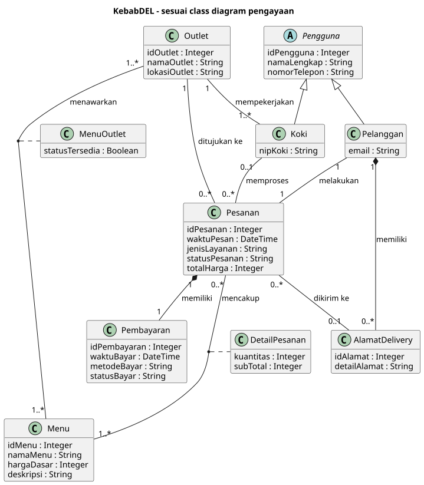

# KebabDEL

Created with [BESSER](https://github.com/BESSER-PEARL/BESSER) on 2026-11-24.

## Class Diagram



## Files

- `buml/diagrams.json`: the model. Open the repository from the GitHub panel of the
  [BESSER Web Editor](https://editor.besser-pearl.org/) to edit it.
- `buml/*.py`: the same model as B-UML Python source.
- `kebabdel/`, `kebabdel_app/`, `manage.py`, `requirements.txt`: the Django project generated from the model.

## Running the application (Django)

### Prerequisites
- Python **3.12 or 3.13**. Python 3.14 is not supported yet because `psycopg-binary` 3.2.4 has no build for it.
- Git.

### Steps

1. Clone the repository and enter the folder:
   ```bash
   git clone https://github.com/applepiesss/rpl-besser.git
   cd rpl-besser
   ```

2. Create and activate a virtual environment:
   ```bash
   python3.12 -m venv venv
   source venv/bin/activate      # macOS / Linux
   venv\Scripts\activate         # Windows
   ```

3. Install the dependencies:
   ```bash
   pip install -r requirements.txt
   ```

4. Create the database tables:
   ```bash
   python manage.py makemigrations
   python manage.py migrate
   ```

5. Create an admin account:
   ```bash
   python manage.py createsuperuser
   ```

6. Start the server:
   ```bash
   python manage.py runserver
   ```

7. Open `http://127.0.0.1:8000/admin/` and log in with the admin account.
   Customers, orders, menus, outlets and the other entities can be managed from there.

Press `Ctrl + C` to stop the server.

## Learn more

- [BESSER on GitHub](https://github.com/BESSER-PEARL/BESSER)
- [Documentation](https://besser.readthedocs.io/)